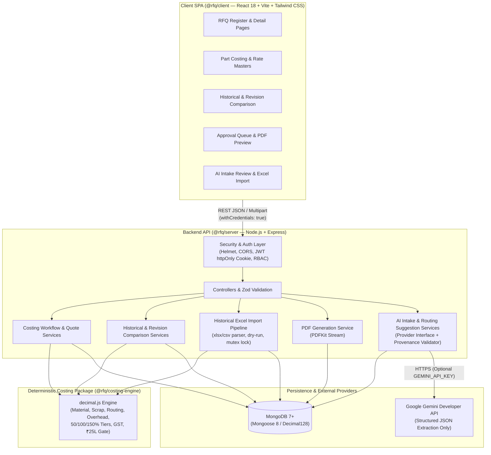

# RFQ-to-Quote Costing App

An enterprise-grade B2B web application built as a TypeScript monorepo to digitize the **Request for Quotation (RFQ) intake, deterministic part costing, multi-tier quotation preparation, commercial approval governance, and historical quote intelligence** workflows for an automotive component manufacturer.

---

## Table of Contents

1. [Project Overview](#1-project-overview)
   - [The Business Problem](#the-business-problem)
   - [Why Manual Excel-Based Costing Creates Inefficiencies](#why-manual-excel-based-costing-creates-inefficiencies)
   - [How the Application Digitizes the Workflow](#how-the-application-digitizes-the-workflow)
   - [End-to-End Business Workflow](#end-to-end-business-workflow)
   - [User Roles & Stakeholders](#user-roles--stakeholders)
2. [Key Features](#2-key-features)
   - [RFQ Management & Commercial Outcomes](#rfq-management--commercial-outcomes)
   - [Deterministic Part Costing Engine (`@rfq/costing-engine`)](#deterministic-part-costing-engine-rfqcosting-engine)
   - [Rate Master Management & Effective-Date Snapshots](#rate-master-management--effective-date-snapshots)
   - [Quote Lifecycle, Governance & PDF Generation](#quote-lifecycle-governance--pdf-generation)
   - [Historical Quote Management & Bulk Excel Import](#historical-quote-management--bulk-excel-import)
   - [AI-Assisted RFQ Intake & Routing Suggestions](#ai-assisted-rfq-intake--routing-suggestions)
3. [Screenshots / Application Preview](#3-screenshots--application-preview)
4. [System Architecture & Monorepo Structure](#4-system-architecture--monorepo-structure)
   - [Monorepo Layout](#monorepo-layout)
   - [System Architecture Diagram](#system-architecture-diagram)
   - [Architectural Layers & Responsibilities](#architectural-layers--responsibilities)
   - [Key Architecture Decision Records (ADRs)](#key-architecture-decision-records-adrs)
5. [Technology Stack](#5-technology-stack)
6. [REST API Reference](#6-rest-api-reference)
7. [Getting Started & Local Development](#7-getting-started--local-development)
   - [Prerequisites](#prerequisites)
   - [Environment Configuration](#environment-configuration)
   - [Installation & Database Seeding](#installation--database-seeding)
   - [Running the Application](#running-the-application)
   - [Available Workspace Scripts](#available-workspace-scripts)
8. [Testing & Verification](#8-testing--verification)

---

## 1. Project Overview

### The Business Problem

In precision automotive component manufacturing (such as CNC-turned spindles, forged lift arms, gear blanks, and transmission shafts for two-wheeler, tractor, and Tier-1 OEM customers in manufacturing hubs like Chakan, Pune), engineering estimation teams receive dozens of RFQs every week across emails, Excel part schedules, and engineering drawings.

Transforming an incoming customer RFQ into a commercially sound quotation requires:
1. Extracting part geometry, material grade (`EN8`, `20MnCr5`, `40Cr4`, `EN353`), gross weight, and annual volume requirements.
2. Defining multi-operation manufacturing routing (CNC Turning, Heavy CNC Machining, VMC Milling, Grinding, Hobbing, Broaching) with operation-level cycle times.
3. Applying effective material rates (₹/kg), machine-hour rates (₹/hr), scrap allowances, factory overhead, setup amortization across volume tiers, packing/freight, margin, and GST.
4. Benchmarking against past quotes for similar parts so pricing stays competitive without eroding margins.
5. Enforcing executive commercial sign-off on high-value quotations before dispatching formal PDFs to the customer.

### Why Manual Excel-Based Costing Creates Inefficiencies

When managed in ad-hoc spreadsheets and email threads:
- **Stale Master Rates:** Estimators copy old spreadsheets containing outdated steel/forging rates or machine-hour rates.
- **Retroactive Corruption:** Updating a linked master rate table in Excel unintentionally alters historical quotes, making it impossible to audit what rates were actually used six months ago.
- **Formula Drift & Floating-Point Errors:** Manual edits overwrite overhead or setup amortization formulas across volume tiers.
- **No Revision Lineage:** Multiple files (`Quote_v1_final_revised.xlsx`) obscure which version was approved, rejected, or sent to the customer.
- **Ungoverned High-Value Quotes:** High-exposure quotes bypass management review without an enforceable approval gate or audit trail.
- **Inaccessible Institutional Memory:** Over 1,400 historical quote rows remain trapped in legacy workbooks instead of surfacing automatically during new part estimation.

### How the Application Digitizes the Workflow

The **RFQ-to-Quote Costing App** replaces disconnected spreadsheets with a single, auditable system of record:
- **Pure, Arbitrary-Precision Costing Engine:** Every financial figure is computed in an isolated `@rfq/costing-engine` package using `decimal.js` (40 significant digits internally, `ROUND_HALF_UP` to 2 decimal places at output boundaries) — zero IEEE 754 floating-point drift.
- **Immutable Rate & Input Snapshots:** Each saved quote version freezes the exact effective-dated material rate, machine-hour rates, overhead settings, routing operations, and 3-tier volume breakdown (`50%`, `100%`, `150%`) at the moment of costing.
- **Strict Commercial Governance:** Quotes with an Annual Quotation Value strictly exceeding **₹25,00,000** (`> ₹25 Lakh`) automatically enter `PENDING_APPROVAL` and require explicit `SALES_HEAD` sign-off before PDF export or customer dispatch.
- **Institutional Memory & AI Acceleration:** Estimators can import legacy Excel quote registers, compare current parts against frozen historical quotes or prior revisions, and use **Google Gemini** to extract structured RFQ drafts from unstructured emails, Excel sheets, and PDF drawings with full source provenance.

### End-to-End Business Workflow

`RFQ Received → RFQ Registration → Part Information → Costing → Historical Comparison → Quote Preparation → Approval → PDF Generation → Sent → Won/Lost Tracking`

```mermaid
flowchart LR
    A["1. RFQ Received<br/>(Email / Excel / Drawing PDF)"] --> B["2. RFQ Registration<br/>(Manual or AI Intake Review)"]
    B --> C["3. Part Information<br/>(Material, Weight, Volume)"]
    C --> D["4. Part Costing<br/>(Routing Ops & Rate Lookup)"]
    D --> E["5. Historical Comparison<br/>(Similar Parts & Prior Revisions)"]
    E --> F["6. Quote Preparation<br/>(Immutable Snapshot v1..vN)"]
    F --> G{"Annual Value<br/>> ₹25,00,000?"}
    G -- "Yes (PENDING_APPROVAL)" --> H["7. Sales Head Approval<br/>(Approve or Reject w/ Reason)"]
    G -- "No (READY_FOR_SALES)" --> I["8. PDF Generation<br/>(3-Tier Commercial Quote)"]
    H -- "Approved" --> I
    H -- "Rejected" --> D
    I --> J["9. Mark as SENT<br/>(Customer Dispatch)"]
    J --> K["10. Commercial Outcome<br/>(WON / LOST + Lost Reason)"]
```



### User Roles & Stakeholders

The application implements role-based access control (RBAC) via JWT `httpOnly` cookies for two primary operational roles:

| Role | Identifier | Core Responsibilities in the Application |
| :--- | :--- | :--- |
| **Estimator** | `ESTIMATOR` | Register RFQs (manually or via AI intake), manage part specifications, maintain effective-dated Material/Machine/Overhead rate masters, build multi-operation routing, run deterministic costing previews, compare against historical quotes and revisions, create immutable quote versions (`v1, v2, ...`), generate quotation PDFs for eligible quotes, and import historical quote workbooks. |
| **Sales Head** | `SALES_HEAD` | All Estimator visibility plus commercial governance: review the **Approval Queue**, inspect cost breakdowns and historical benchmarks, **Approve** or **Reject** (with mandatory comment) quotes exceeding ₹25 Lakh annual value, mark eligible quotes as **SENT**, and record final RFQ commercial outcomes (**WON** or **LOST** with structured lost reason codes). |

> **Business Context Note:** In an automotive manufacturing organization, stakeholders such as the **Plant Head** (shop-floor capacity and cycle-time feasibility) and **Managing Director** (strategic customer pricing) consume the outputs and audit trails of this system, while day-to-day system execution is consolidated under the **Estimator** and **Sales Head** roles.

---

## 2. Key Features

### RFQ Management & Commercial Outcomes

- **Centralized RFQ Register:** Searchable and filterable register displaying RFQ number (`rfqNo`), customer name, part summary, owner, received date, due date, current quote status, and commercial status badge.
- **Overdue Detection:** Server-computed `isOverdue` indicator highlights RFQs whose `dueDate` has passed while not yet `SENT` or `WON`.
- **Separation of Quote Lifecycle and RFQ Commercial Outcome:**
  - **Quote Lifecycle (`Quote.status`):** Tracks internal engineering and approval states per quote version (`DRAFT`, `READY_FOR_SALES`, `PENDING_APPROVAL`, `APPROVED`, `REJECTED`, `SENT`).
  - **RFQ Commercial Status (`RFQ.status`):** Tracks the business lifecycle of the opportunity (`ESTIMATING`, `SENT`, `PENDING_APPROVAL`, `WON`, `LOST`).
- **Automated & Governed Commercial Transitions:**
  - Marking an eligible quote as `SENT` automatically advances the parent RFQ status to `SENT` and stamps `sentAt` and `sentBy`.
  - Only an RFQ in `SENT` status with at least one `SENT` quote can transition to terminal commercial outcomes `WON` or `LOST` (restricted to `SALES_HEAD`).
  - Recording a `LOST` outcome requires a structured `lostReason` (`PRICE_TOO_HIGH`, `DELIVERY_TIMELINE`, `COMPETITOR_SELECTED`, `TECHNICAL_REJECTION`, `CUSTOMER_CANCELLED`, `OTHER`); selecting `OTHER` enforces a non-empty `lostReasonNote`.

---

### Deterministic Part Costing Engine (`@rfq/costing-engine`)

All financial calculations reside in `packages/costing-engine` — a pure, zero-I/O TypeScript package with no database, HTTP, or framework dependencies. Every calculation uses `decimal.js` configured with `precision: 40` and `ROUND_HALF_UP` to 2 decimal places at output boundaries.

#### Costing Methodology & Exact Formulas

Given a part's `grossWeightKg`, `annualVolume`, material rate (`materialRatePerKg`), ordered routing operations $i = 1 \dots n$ with `cycleTimeMinutes` and `machineHourRate`, and global rate settings (`scrapPct`, `overheadPct`, `packingFreightPerPiece`, `setupCostPerPart`, `defaultMarginPct`, `gstPct`):

1. **Material Cost per Piece:**
   $$\text{materialCost} = \text{grossWeightKg} \times \text{materialRatePerKg}$$

2. **Scrap Allowance per Piece:**
   $$\text{scrapCost} = \text{materialCost} \times \left(\frac{\text{scrapPct}}{100}\right)$$

3. **Routing & Machine Conversion Cost per Piece:**
   $$\text{operationCost}_i = \left(\frac{\text{cycleTimeMinutes}_i}{60}\right) \times \text{machineHourRate}_i$$
   $$\text{conversionCost} = \sum_{i=1}^{n} \text{operationCost}_i$$

4. **Overhead Cost per Piece** *(applied strictly to manufacturing cost — packing/freight and setup are excluded from the overhead basis)*:
   $$\text{overheadCost} = (\text{materialCost} + \text{scrapCost} + \text{conversionCost}) \times \left(\frac{\text{overheadPct}}{100}\right)$$

5. **Base Manufacturing Cost per Piece** *(constant across all volume tiers)*:
   $$\text{baseManufacturingCost} = \text{materialCost} + \text{scrapCost} + \text{conversionCost} + \text{overheadCost}$$

6. **Three Volume Tiers (`50% Low`, `100% Base`, `150% High`):**
   For each tier factor $f \in \{0.50, 1.00, 1.50\}$:
   - $\text{tierVolume} = \text{round\_half\_up}(\text{annualVolume} \times f)$
   - $\text{setupAllocationPerPiece} = \dfrac{\text{setupCostPerPart}}{\text{tierVolume}}$
   - $\text{totalCostPerPiece} = \text{baseManufacturingCost} + \text{packingFreightPerPiece} + \text{setupAllocationPerPiece}$
   - $\text{sellingPriceExGst} = \text{totalCostPerPiece} \times \left(1 + \dfrac{\text{defaultMarginPct}}{100}\right)$
   - $\text{marginAmount} = \text{round2dp}(\text{sellingPriceExGst}) - \text{round2dp}(\text{totalCostPerPiece})$

7. **GST Calculated and Displayed Separately:**
   GST is computed on the **rounded Ex-GST selling price** and kept strictly separate from the Ex-GST commercial price:
   $$\text{gstAmount} = \text{round2dp}(\text{sellingPriceExGst}) \times \left(\frac{\text{gstPct}}{100}\right)$$
   $$\text{sellingPriceIncludingGst} = \text{round2dp}(\text{sellingPriceExGst}) + \text{round2dp}(\text{gstAmount})$$

8. **Annual Quotation Value & Approval Gate:**
   $$\text{annualQuotationValue} = \text{round2dp}(\text{baseTier}_{100\%}.\text{sellingPriceExGst}) \times \text{annualVolume}$$
   $$\text{requiresApproval} = \text{annualQuotationValue} > 25,00,000\text{ INR}$$

---

### Rate Master Management & Effective-Date Snapshots

- **Three Versioned Rate Masters:**
  - **Material Rates (`MaterialRate`):** Material grade (`EN8`, `40Cr4`, `20MnCr5`, `EN353`, etc.), specification, ₹/kg (`Decimal128`), and `effectiveFrom` date.
  - **Machine-Hour Rates (`MachineRate`):** Machine name (`Standard CNC Turning`, `Heavy CNC Machining`, `VMC Milling`, `Grinding`, etc.), category, ₹/hr (`Decimal128`), and `effectiveFrom` date.
  - **Global Rate Settings (`RateSetting`):** `scrapPct`, `overheadPct`, `packingFreight`, `defaultMarginPct`, `gstPct`, `setupCostPerPart`, and `effectiveFrom` date.
- **Append-Only Effective-Date Lookup:** Rate masters are never mutated destructively in place. When a rate changes, a new effective-dated record is inserted. For any `costingDate`, the backend queries `{ effectiveFrom: { $lte: costingDate } }` sorted by `{ effectiveFrom: -1 }` to resolve the exact rate in effect on that date.
- **Why Effective-Dated Rates & Snapshots Matter:** In automotive manufacturing, steel and forging indices fluctuate quarterly. By combining effective-dated rate lookups with an embedded `rateSnapshot` inside every saved `Quote` document, revising a master rate in July never alters a quote created in January, and historical quotes from previous years can be re-evaluated against the exact rates that were active on their original quotation date.

---

### Quote Lifecycle, Governance & PDF Generation

- **Immutable Quote Versions:** Saving a quote creates `v1` (`version: 1`, `isLatest: true`). Subsequent revisions atomically mark the prior version `isLatest: false` and insert `v2`, `v3`, etc., linked via `parentQuoteId`. Saved financial snapshots are never overwritten.
- **₹25 Lakh Approval Threshold:**
  - If `annualQuotationValue <= ₹25,00,000`, the quote version is created with status `READY_FOR_SALES`.
  - If `annualQuotationValue > ₹25,00,000`, the quote version is created with status `PENDING_APPROVAL` and appears in the Sales Head **Approval Queue**.
- **Sales Head Approval & Rejection:**
  - Approving transitions the quote from `PENDING_APPROVAL` to `APPROVED`.
  - Rejecting requires a mandatory non-empty `comment` and transitions the quote to `REJECTED` so the Estimator can adjust inputs or margin and create a new revision.
- **Audit Trail (`QuoteEvent`):** Every creation, revision, approval, rejection, dispatch (`SENT`), and commercial outcome (`WON`/`LOST`) writes an immutable `QuoteEvent` entry recording the actor, timestamp, before/after state, and comment.
- **Server-Side PDF Generation (`PDFKit`):** Generates a multi-section commercial quotation PDF containing RFQ/customer metadata, part specifications, routing summary, full cost breakdown, 3-tier volume pricing (`50%`, `100%`, `150%`), separate GST breakdown, and approval metadata. PDF generation is strictly gated to quotes in `APPROVED`, `READY_FOR_SALES`, or `SENT` status.

---

### Historical Quote Management & Bulk Excel Import

- **Historical Quote Search & Similarity Scoring:** Automatically discovers comparable historical quotes for a target part using four transparent matching criteria:
  - Exact drawing number match (`EXACT_DRAWING_NUMBER`)
  - Identical material grade (`SAME_MATERIAL`)
  - Gross weight within `±35%` tolerance (`SIMILAR_WEIGHT`)
  - Shared part name keywords (`SIMILAR_PART_NAME`)
- **Side-by-Side Historical Comparison:** Compares a current quote version against any historical quote across `50%`, `100%`, or `150%` volume tiers, computing exact `decimal.js` deltas (`current - historical`) and percentage changes for material rate, conversion cost, overhead, total cost, Ex-GST selling price, and annual value, plus an operation-by-operation routing diff.
- **Quote Revision Comparison:** Compares any two versions (`versionA` vs `versionB`) of the same part on an RFQ, highlighting rate changes, routing operation changes (`ADDED`, `REMOVED`, `MODIFIED`, `UNCHANGED`), 3-tier cost deltas, and GST diffs.
- **Historical Quote Excel/CSV Importer & 1,400-Row Synthetic Dataset:**
  - **Bulk Workbook Parsing:** Accepts `.xlsx`, `.xls`, and `.csv` files up to `5,000` rows with flexible header alias normalization.
  - **Dry-Run Validation (`dryRun=true`):** Simulates the entire import and returns row-level status (`IMPORTED_COMPLETE`, `SKIPPED_INCOMPLETE`, `SKIPPED_DUPLICATE`, `FAILED_VALIDATION`) without writing to MongoDB.
  - **Zero Fabrication Guarantee:** Rows missing required costing fields are explicitly skipped (`SKIPPED_INCOMPLETE`) rather than inventing synthetic cycle times or rates.
  - **Idempotency & Concurrency Protection:** Deduplicates both intra-file and against existing database records via deterministic SHA-256 `externalRowKey` fingerprints, guarded by an in-process mutex (`withImportWriteLock`) and compensating rollback on batch failure.
  - **Stated vs. Calculated Price Discrepancy Tracking:** Preserves the workbook's stated historical price (`historicalStatedPriceExGst`) alongside the costing engine's deterministic calculation, flagging discrepancies `> ₹0.05` (`priceDiscrepancyFlag: true`).
  - **Synthetic Demo Dataset (`1,400` Rows):** Includes a built-in generator and downloadable template producing 1,400 realistic Chakan automotive component rows across two-wheeler, tractor, and Tier-1 OEM customers (`2023–2025`), explicitly badged across the UI and database as `SYNTHETIC DEMO DATA` (`isSyntheticDemo: true`, `importSource: 'HISTORICAL_EXCEL_SYNTHETIC_DEMO'`).

---

### AI-Assisted RFQ Intake & Routing Suggestions

> **Core Architectural Boundary:** AI (`Google Gemini Developer API`) is used **exclusively** for unstructured document extraction and historical routing candidate suggestions. **AI never calculates costs, looks up rates, or creates database records without explicit human review.** All financial math is executed deterministically by `@rfq/costing-engine`.

- **Multi-Source Unstructured Extraction:**
  - **Email Text (`POST /api/intake/extract/email`):** Extracts customer, RFQ number, due date, and line-item parts with verbatim line/snippet provenance.
  - **Excel Part Lists (`POST /api/intake/extract/excel`):** Parses `.xlsx`/`.xls` workbooks (capped at 5 MB / 200 non-empty rows for AI intake) and preserves exact `SheetName!CellAddress` cell references for every extracted field.
  - **Engineering Drawing PDFs (`POST /api/intake/extract/pdf`):** Extracts embedded text via `pdf-parse` (capped at 10 MB / 20 pages) and attributes extracted dimensions, material specs, and part numbers to page numbers and verbatim text snippets. Every field extracted from a PDF is automatically marked for mandatory Estimator verification (`requiresReview: true`).
- **Mandatory Human-in-the-Loop Review Workflow:**
  - Extracted candidates are saved as an `IntakeDraft` (`EXTRACTED` → `REVIEWED` → `CONVERTED`).
  - The Estimator must explicitly mark each candidate field or part as `ACCEPT`, `EDIT`, or `REJECT` before calling `POST /api/intake/drafts/:id/convert` to atomically create the `RFQ` and `Part` documents.
- **AI-Assisted Historical Routing Suggestions (`POST /api/parts/:id/routing-suggestions`):** Suggests candidate machine sequences and cycle times based strictly on real historical quotes in MongoDB, citing the source historical quote IDs and RFQ numbers.
- **Graceful Failure Handling:** If `GEMINI_API_KEY` is not configured, AI endpoints return a structured `503 AI_NOT_CONFIGURED` response (never fake or canned mock data), and the UI seamlessly guides the user to standard manual RFQ entry or deterministic historical comparison.

---

## 3. Screenshots / Application Preview

> **Placeholder — No Screenshot Assets Currently Committed in Repository**
>
> The repository currently does not contain committed image files (`.png`, `.jpg`, `.webp`). To add screenshots later, save your captures under `docs/screenshots/` using the filenames below and uncomment or link them in this table:

| Screen / Workflow | Suggested Asset Path | Description |
| :--- | :--- | :--- |
| **RFQ Register** | `docs/screenshots/01-rfq-register.png` | Filterable RFQ dashboard showing overdue badges, commercial outcomes (`ESTIMATING`, `SENT`, `WON`, `LOST`), and quick actions. |
| **Part Costing & 3-Tier Breakdown** | `docs/screenshots/02-part-costing.png` | Multi-operation routing editor, effective rate lookup, and live `50% / 100% / 150%` volume tier costing table with separate GST display. |
| **Historical & Revision Comparison** | `docs/screenshots/03-quote-comparison.png` | Side-by-side delta analysis comparing current costing against frozen historical quotes or prior quote revisions (`v1` vs `v2`). |
| **Sales Head Approval Queue** | `docs/screenshots/04-approval-queue.png` | Governance view for quotes exceeding the ₹25,00,000 annual quotation value threshold with approve/reject controls and audit log. |
| **AI Intake & Provenance Review** | `docs/screenshots/05-ai-intake-review.png` | Side-by-side extraction review displaying confidence badges, `Sheet!Cell` / PDF snippet provenance, and `Accept / Edit / Reject` controls. |
| **Historical Excel Import** | `docs/screenshots/06-historical-import.png` | 1,400-row synthetic workbook generator, dry-run validation summary, and row-level discrepancy/provenance inspection. |

---

## 4. System Architecture & Monorepo Structure

### Monorepo Layout

The project is organized as an **npm workspaces** monorepo with four workspace packages (`packages/costing-engine`, `shared`, `server`, `client`) and architectural documentation in `docs/`:

```text
RFQ-to-Quote-Costing-app/
├── package.json                  # Root workspace orchestrator & scripts
├── tsconfig.base.json            # Shared strict TypeScript compiler configuration
├── .env.example                  # Root environment variable template
├── docs/
│   └── architecture.md           # Architecture Decision Records (ADR-001 to ADR-006)
├── packages/
│   └── costing-engine/           # Pure, zero-dependency TypeScript costing engine (@rfq/costing-engine)
│       ├── src/
│       │   ├── index.ts          # Public API exports
│       │   ├── engine.ts         # Main calculatePartCosting() orchestrator
│       │   ├── components.ts     # Material, scrap, conversion & overhead formulas
│       │   ├── tiers.ts          # 50% / 100% / 150% volume tiers & separate GST math
│       │   ├── approval.ts       # ₹25,00,000 (APPROVAL_THRESHOLD_INR) check
│       │   ├── precision.ts      # decimal.js configuration (40-digit precision, ROUND_HALF_UP)
│       │   ├── validation.ts     # Domain input validation rules
│       │   └── types.ts          # CostingInput, CostingResult, VolumeTierResult types
│       └── tests/                # 5 Vitest unit test suites (142 tests)
├── shared/                       # Shared TypeScript domain union types (@rfq/shared)
│   └── src/
│       └── index.ts              # UserRole, RFQStatus, QuoteStatus types
├── server/                       # Node.js + Express + Mongoose REST API (@rfq/server)
│   ├── src/
│   │   ├── app.ts                # Express middleware & route mounting
│   │   ├── index.ts              # HTTP server entry point & MongoDB bootstrap
│   │   ├── config/               # Environment validation (env.ts) & DB connection
│   │   ├── middleware/           # JWT cookie authenticate & RBAC authorize middleware
│   │   ├── models/               # Mongoose schemas (User, RFQ, Part, Quote, QuoteEvent,
│   │   │                         # MaterialRate, MachineRate, RateSetting, IntakeDraft)
│   │   ├── services/             # Business logic: costingWorkflow, quote, quoteComparison,
│   │   │                         # historicalComparison, historicalQuoteImport, quotePdf,
│   │   │                         # intakeExtraction, routingSuggestion, geminiProvider,
│   │   │                         # syntheticHistoricalDataset
│   │   ├── controllers/          # Express route handlers & Zod request validation
│   │   ├── routes/               # Modular routers (auth, rfq, part, quote, approval, intake)
│   │   └── seed/                 # Idempotent demo seed script (seed.ts)
│   └── tests/                    # 13 Vitest + Supertest + mongodb-memory-server suites (197 tests)
└── client/                       # React 18 + Vite + Tailwind CSS SPA (@rfq/client)
    └── src/
        ├── App.tsx               # Client router & protected route definitions
        ├── api/                  # Axios client & typed API modules
        ├── context/              # AuthContext (session recovery & role helpers)
        ├── components/           # AppLayout, badges, UI primitives, comparison panels
        └── pages/                # 11 application screens (Login, RFQList, RFQCreate,
                                  # RFQDetail, PartCosting, QuoteDetail, ApprovalQueue,
                                  # RateMasters, HistoricalImport, IntakeList, IntakeReview)
```

### System Architecture Diagram



### Architectural Layers & Responsibilities

1. **Frontend (`client/`):** React 18 single-page application using React Router v6, Tailwind CSS, and `lucide-react` icons. All financial numbers are rendered from backend string/number payloads without client-side business recalculation.
2. **Backend / API Layer (`server/`):** Express 4 REST API secured with `helmet`, strict CORS origin validation, and `zod` request schema validation.
3. **Authentication & Authorization (`server/src/middleware/`):** Stateless JWT stored in an `httpOnly`, `SameSite=Lax` cookie (`rfq_token`) to prevent XSS token theft. Route-level `authenticate` and `authorize('ESTIMATOR' | 'SALES_HEAD')` middleware enforce role boundaries on the server.
4. **Database & Persistence (`server/src/models/`):** MongoDB with Mongoose 8. Monetary values are stored using `mongoose.Types.Decimal128` to preserve exact decimal representation at rest.
5. **Costing Engine (`packages/costing-engine/`):** Pure TypeScript module invoked by `costingWorkflow.service.ts` and `historicalQuoteImport.service.ts`. Guarantees identical results across live previews, saved quotes, and imported historical rows.
6. **AI Provider Abstraction (`server/src/services/aiProvider.interface.ts` & `geminiProvider.ts`):** Decouples business services from the underlying LLM SDK via the `AIExtractionProvider` interface, validates structured JSON outputs with `zod`, and enforces provenance links before persisting `IntakeDraft` documents.
7. **PDF Generation (`server/src/services/quotePdf.service.ts`):** Server-side `PDFKit` document builder that streams formatted commercial quotation PDFs directly from immutable `Quote` snapshots.
8. **Historical Import Pipeline (`server/src/services/historicalQuoteImport.service.ts`):** Multi-stage deterministic pipeline performing header normalization, row validation, effective rate fallback resolution, `@rfq/costing-engine` execution, stated-price discrepancy checks, SHA-256 `externalRowKey` deduplication, concurrency locking, and compensating transaction rollback.

### Key Architecture Decision Records (ADRs)

Documented in [`docs/architecture.md`](docs/architecture.md):
- **ADR-001:** npm Workspaces Monorepo for shared TypeScript compilation and isolated `@rfq/costing-engine` testing.
- **ADR-002:** Costing Engine as a Pure Package with Zero External I/O Dependencies (`decimal.js` only).
- **ADR-003:** Immutable Rate Snapshots on Quote Creation (`rateSnapshot`, `costingInputSnapshot`, `volumeTierResults`).
- **ADR-004:** Effective-Dated Rate Master Tables (append-only versioned rows queried by `effectiveFrom <= costingDate`).
- **ADR-005:** `httpOnly` Cookie JWT Authentication over `localStorage` to mitigate XSS token exfiltration.
- **ADR-006:** Separate Quote Lifecycle Status (`Quote.status`) from RFQ Commercial Status (`RFQ.status`).

---

## 5. Technology Stack

All versions below are verified directly from the repository's `package.json` files:

| Layer | Technology | Version | Purpose |
| :--- | :--- | :--- | :--- |
| **Runtime & Language** | Node.js | `>= 20.0.0` | Server runtime & npm workspace orchestration |
| | TypeScript | `^5.4.0` | Strict static typing across all 4 workspaces |
| **Frontend (`client/`)** | React & React DOM | `^18.3.0` | Component UI library |
| | React Router DOM | `^6.23.0` | Client-side routing & protected role routes |
| | Vite | `^5.2.0` | Frontend build tool & dev server (`:5173`) |
| | Tailwind CSS | `^3.4.3` | Utility-first styling & design system tokens |
| | Lucide React | `^1.16.0` | Enterprise SVG iconography |
| | Axios | `^1.7.0` | HTTP client with `withCredentials` cookie support |
| **Backend (`server/`)** | Express.js | `^4.19.2` | REST API framework |
| | MongoDB & Mongoose | `^8.4.0` | Document database & ODM with `Decimal128` support |
| | Zod | `^3.23.0` | Request payload & AI JSON schema validation |
| | JSON Web Token (`jsonwebtoken`) | `^9.0.2` | Stateless session signing (`httpOnly` cookie) |
| | `bcryptjs` | `^2.4.3` | Password hashing (12 rounds default) |
| | Helmet & CORS | `^7.1.0` / `^2.8.5` | HTTP security headers & cross-origin policy |
| | Multer | `^2.5.0` | Multipart file upload handling (in-memory buffer) |
| | SheetJS (`xlsx`) | `^0.18.5` | Excel/CSV parsing & workbook template generation |
| | `pdf-parse` | `^2.4.5` | Drawing PDF text extraction |
| | `PDFKit` | `^0.15.0` | Server-side commercial quotation PDF generation |
| **Costing (`packages/costing-engine`)** | `decimal.js` | `^10.4.3` | Arbitrary-precision decimal arithmetic |
| **AI Integration** | Google Gemini REST API | `gemini-2.5-flash` (configurable) | Structured JSON extraction & routing suggestions |
| **Testing** | Vitest | `^1.6.1` | Unit & integration test runner |
| | Supertest | `^7.0.0` | Express HTTP endpoint integration testing |
| | `mongodb-memory-server` | `^10.0.0` | Ephemeral in-memory MongoDB for deterministic tests |

---

## 6. REST API Reference

All endpoints are prefixed with `/api`. Protected routes require a valid `rfq_token` `httpOnly` cookie obtained from `POST /api/auth/login`.

### Health & Authentication (`/api/health`, `/api/auth`)

| Method | Endpoint | Auth / Role | Description |
| :--- | :--- | :--- | :--- |
| `GET` | `/api/health` | Public | Health check returning `{ status: "ok", timestamp }` |
| `POST` | `/api/auth/login` | Public | Authenticate with `{ email, password }`; sets `rfq_token` cookie |
| `POST` | `/api/auth/logout` | Authenticated | Clear the `rfq_token` session cookie |
| `GET` | `/api/auth/me` | Authenticated | Return current authenticated user profile & role |

### RFQs, Parts, Costing, Quotes & Historical Import (`/api/rfqs`)

| Method | Endpoint | Auth / Role | Description |
| :--- | :--- | :--- | :--- |
| `GET` | `/api/rfqs` | Authenticated | List RFQs with optional `status`, `customer`, `search` filters |
| `POST` | `/api/rfqs` | `ESTIMATOR`, `SALES_HEAD` | Create a new RFQ |
| `GET` | `/api/rfqs/:id` | Authenticated | Get RFQ details, parts list, and computed `isOverdue` flag |
| `PATCH` | `/api/rfqs/:id` | `ESTIMATOR`, `SALES_HEAD` | Update general RFQ metadata (`customer`, `dueDate`) |
| `PATCH` | `/api/rfqs/:id/outcome` | `SALES_HEAD` | Record commercial outcome (`WON` or `LOST` with `lostReason`) |
| `POST` | `/api/rfqs/:id/parts` | `ESTIMATOR`, `SALES_HEAD` | Add a part to an RFQ |
| `PATCH` | `/api/rfqs/:id/parts/:partId` | `ESTIMATOR`, `SALES_HEAD` | Update part specifications (`material`, `grossWeightKg`, `annualVolume`, etc.) |
| `POST` | `/api/rfqs/:id/parts/:partId/costing-preview` | `ESTIMATOR`, `SALES_HEAD` | Run stateless costing preview without saving a quote |
| `POST` | `/api/rfqs/:id/parts/:partId/quotes` | `ESTIMATOR`, `SALES_HEAD` | Create initial immutable quote (`v1`) with frozen snapshots |
| `POST` | `/api/rfqs/:id/parts/:partId/quotes/revise` | `ESTIMATOR`, `SALES_HEAD` | Create a new immutable quote revision (`v2..vN`) |
| `GET` | `/api/rfqs/:id/parts/:partId/quotes/compare` | Authenticated | Compare two quote revisions (`?versionA=1&versionB=2`) |
| `GET` | `/api/rfqs/:id/quotes` | Authenticated | List all quote versions and `QuoteEvent` history for an RFQ |
| `GET` | `/api/rfqs/historical-import/template` | `ESTIMATOR`, `SALES_HEAD` | Download synthetic 1,400-row `.xlsx`/`.csv` demo workbook |
| `POST` | `/api/rfqs/historical-import/generate-synthetic` | `ESTIMATOR`, `SALES_HEAD` | Generate & import (or dry-run) the 1,400-row synthetic dataset |
| `POST` | `/api/rfqs/historical-import` | `ESTIMATOR`, `SALES_HEAD` | Upload & import (or `dryRun=true` validate) an Excel/CSV historical workbook |

### Rate Masters & Approvals (`/api/rfqs/rates`, `/api/approvals`)

| Method | Endpoint | Auth / Role | Description |
| :--- | :--- | :--- | :--- |
| `GET` | `/api/rfqs/rates/materials` | Authenticated | List effective-dated material rates |
| `POST` | `/api/rfqs/rates/materials` | `ESTIMATOR`, `SALES_HEAD` | Insert a new effective-dated material rate |
| `GET` | `/api/rfqs/rates/machines` | Authenticated | List effective-dated machine-hour rates |
| `POST` | `/api/rfqs/rates/machines` | `ESTIMATOR`, `SALES_HEAD` | Insert a new effective-dated machine-hour rate |
| `GET` | `/api/rfqs/rates/settings` | Authenticated | List effective-dated overhead & global rate settings |
| `POST` | `/api/rfqs/rates/settings` | `ESTIMATOR`, `SALES_HEAD` | Insert a new effective-dated rate setting |
| `GET` | `/api/approvals` | `SALES_HEAD` | List all quotes currently in `PENDING_APPROVAL` |
| `POST` | `/api/approvals/:quoteId/approve` | `SALES_HEAD` | Approve a pending quote (`PENDING_APPROVAL` → `APPROVED`) |
| `POST` | `/api/approvals/:quoteId/reject` | `SALES_HEAD` | Reject a pending quote with mandatory `comment` (`→ REJECTED`) |
| `POST` | `/api/approvals/:quoteId/send` | `ESTIMATOR`, `SALES_HEAD` | Mark an `APPROVED` or `READY_FOR_SALES` quote as `SENT` |

### Quotes, PDF Export & Historical Comparison (`/api/quotes`, `/api/parts`)

| Method | Endpoint | Auth / Role | Description |
| :--- | :--- | :--- | :--- |
| `GET` | `/api/quotes/:id` | Authenticated | Get full quote snapshot, volume tiers, and event log |
| `GET` | `/api/quotes/:id/pdf` | `ESTIMATOR`, `SALES_HEAD` | Generate & stream commercial quotation PDF (`application/pdf`) |
| `GET` | `/api/quotes/:id/compare/:historicalQuoteId` | Authenticated | Compare current quote vs. historical quote (`?tier=50\|100\|150`) |
| `GET` | `/api/parts/:id/historical-matches` | Authenticated | Find similar historical quotes for a part with similarity scores |
| `POST` | `/api/parts/:id/routing-suggestions` | `ESTIMATOR`, `SALES_HEAD` | Generate AI-assisted routing suggestions backed by historical quotes |

### AI-Assisted RFQ Intake (`/api/intake`)

| Method | Endpoint | Auth / Role | Description |
| :--- | :--- | :--- | :--- |
| `POST` | `/api/intake/extract/email` | `ESTIMATOR`, `SALES_HEAD` | Extract structured `IntakeDraft` from raw customer email text |
| `POST` | `/api/intake/extract/excel` | `ESTIMATOR`, `SALES_HEAD` | Extract structured `IntakeDraft` from uploaded `.xlsx`/`.xls` (`file` field) |
| `POST` | `/api/intake/extract/pdf` | `ESTIMATOR`, `SALES_HEAD` | Extract structured `IntakeDraft` from uploaded drawing `.pdf` (`file` field) |
| `GET` | `/api/intake/drafts` | `ESTIMATOR`, `SALES_HEAD` | List recent AI extraction drafts |
| `GET` | `/api/intake/drafts/:id` | `ESTIMATOR`, `SALES_HEAD` | Retrieve an `IntakeDraft` with field-level provenance & confidence |
| `PATCH` | `/api/intake/drafts/:id/review` | `ESTIMATOR`, `SALES_HEAD` | Save Estimator `ACCEPT`, `EDIT`, or `REJECT` decisions on a draft |
| `POST` | `/api/intake/drafts/:id/convert` | `ESTIMATOR`, `SALES_HEAD` | Convert a reviewed draft into persistent `RFQ` and `Part` records |

---

## 7. Getting Started & Local Development

### Prerequisites

- **Node.js:** `>= 20.0.0` (with npm workspaces support)
- **MongoDB:** Local MongoDB `7.0+` instance running on `mongodb://localhost:27017` or a MongoDB Atlas connection URI

### Environment Configuration

Copy the example environment file to `server/.env`:

```bash
cp server/.env.example server/.env
```

Configure the variables in `server/.env`:

| Variable | Required | Default | Description |
| :--- | :--- | :--- | :--- |
| `PORT` | No | `5000` | Express server listening port |
| `NODE_ENV` | No | `development` | Runtime environment (`development`, `production`, `test`) |
| `MONGODB_URI` | **Yes** | — | MongoDB connection string (e.g., `mongodb://localhost:27017/rfq_costing_dev`) |
| `JWT_SECRET` | **Yes** | — | Secret key for signing JWT cookies (minimum 32 random characters) |
| `JWT_EXPIRES_IN` | No | `8h` | JWT session expiration window |
| `BCRYPT_ROUNDS` | No | `12` | bcrypt cost factor for user password hashing |
| `CLIENT_URL` | No | `http://localhost:5173` | Allowed CORS origin for the React frontend |
| `SEED_ESTIMATOR_PASSWORD` | For `npm run seed` | — | Password assigned to `estimator@demo.com` during seeding |
| `SEED_SALES_PASSWORD` | For `npm run seed` | — | Password assigned to `sales@demo.com` during seeding |
| `GEMINI_API_KEY` | Optional | `""` | Google Gemini Developer API key for AI Intake & Routing Suggestions. If omitted, AI endpoints gracefully return `AI_NOT_CONFIGURED` (`503`) while all core costing/import workflows remain 100% functional. |
| `GEMINI_MODEL` | No | `gemini-2.5-flash` | Gemini model identifier used when `GEMINI_API_KEY` is provided |

### Installation & Database Seeding

1. **Install all workspace dependencies from the repository root:**
   ```bash
   npm install
   ```

2. **Seed the database with demo users, effective-dated material/machine rates, rate settings, and sample RFQs:**
   ```bash
   npm run seed
   ```
   *(Ensure `MONGODB_URI`, `SEED_ESTIMATOR_PASSWORD`, and `SEED_SALES_PASSWORD` are set in `server/.env` before running `npm run seed`.)*

   The seed script is idempotent and creates:
   - **Estimator Account:** `estimator@demo.com` (password from `SEED_ESTIMATOR_PASSWORD`)
   - **Sales Head Account:** `sales@demo.com` (password from `SEED_SALES_PASSWORD`)
   - **Material Rates:** `EN8` (`₹52.00/kg` eff. `2024-01-01`, `₹55.00/kg` eff. `2024-07-01`), `40Cr4` (`₹78.00/kg`), `20MnCr5` (`₹82.00/kg`)
   - **Machine Rates:** `Standard CNC Turning` (`₹850/hr`), `Heavy CNC Machining` (`₹1,450/hr`), `VMC Milling` (`₹950/hr`), `Grinding` (`₹750/hr`)
   - **Rate Settings:** `5%` scrap, `150%` overhead, `₹2.50` packing/freight, `15%` default margin, `18%` GST, `₹0.50` setup cost
   - **Sample RFQs:** `RFQ-2611-014` (Rear wheel spindle — overdue), `RFQ-2611-019` (Hydraulic lift arm), `RFQ-2611-023` (Gear blank)

### Running the Application

Start both the backend API server (`http://localhost:5000`) and the Vite React frontend (`http://localhost:5173`, with `/api` proxied to `:5000`) concurrently:

```bash
npm run dev
```

Or run each workspace individually in separate terminals:

```bash
# Terminal 1 — Backend API (:5000)
npm run dev:server

# Terminal 2 — React Frontend (:5173)
npm run dev:client
```

### Available Workspace Scripts

Verified from the root `package.json`:

| Command | Description |
| :--- | :--- |
| `npm run dev` | Run `server` and `client` concurrently in watch mode |
| `npm run dev:server` | Start the Express backend in development watch mode (`tsx watch`) |
| `npm run dev:client` | Start the Vite frontend development server |
| `npm run build` | Build `@rfq/costing-engine`, `@rfq/shared`, `@rfq/server`, and `@rfq/client` for production |
| `npm run seed` | Run the idempotent database seed script (`server/src/seed/seed.ts`) |
| `npm run test:engine` | Execute the Vitest unit test suite for `@rfq/costing-engine` |
| `npm run test:server` | Execute the Vitest integration & unit test suite for `@rfq/server` |
| `npm run typecheck` | Run `tsc --noEmit` across `@rfq/costing-engine`, `@rfq/server`, and `@rfq/client` |

---

## 8. Testing & Verification

The repository includes **339 automated tests** across **18 test suites**, using Vitest, Supertest, and `mongodb-memory-server` (zero external database required to run tests):

1. **Costing Engine Unit Tests (`packages/costing-engine/tests/` — 5 suites, 142 tests):**
   - `precision.test.ts` — Decimal rounding (`ROUND_HALF_UP`), string serialization, and precision invariants.
   - `components.test.ts` — Material cost, scrap allowance, multi-operation conversion cost, and overhead basis exclusion rules.
   - `tiers.test.ts` — `50%`, `100%`, `150%` volume tier scaling, setup amortization, and separate GST calculation.
   - `approval.test.ts` — Strict `> ₹25,00,000` (`APPROVAL_THRESHOLD_INR`) boundary verification (`2500000.00` vs `2500000.01`).
   - `engine.test.ts` — End-to-end deterministic costing orchestration and input validation errors.

2. **Backend API & Workflow Integration Tests (`server/tests/` — 13 suites, 197 tests):**
   - `auth.test.ts` — Login, `httpOnly` cookie issuance, session recovery, and invalid credential rejection.
   - `rfq.test.ts` — RFQ and Part CRUD, overdue detection, and RBAC enforcement.
   - `rfqOutcome.test.ts` — `ESTIMATING` → `SENT` → `WON`/`LOST` transitions and structured `lostReason` validation.
   - `rates.test.ts` — Append-only effective-dated Material, Machine, and RateSetting lookup semantics.
   - `costingWorkflow.test.ts` — Stateless costing preview, immutable `v1..vN` quote creation, and snapshot preservation.
   - `approval.test.ts` — ₹25 Lakh approval gating, Sales Head approval/rejection, mandatory rejection comments, and `QuoteEvent` audit logs.
   - `pdfAndCompare.test.ts` — `PDFKit` quotation PDF binary streaming and status eligibility gates.
   - `quoteRevisionComparison.test.ts` — Side-by-side quote revision diffs across rates, routing operations, and volume tiers.
   - `historicalImport.test.ts` — 1,400-row synthetic generator, Excel/CSV import, `dryRun=true` zero-write guarantee, compensating rollback on failure, concurrent import locking, and duplicate detection.
   - `intakeAndRouting.test.ts`, `intakeHardening.test.ts`, `pdfExtraction.test.ts`, `geminiProvider.test.ts` — AI intake extraction, cell/page provenance validation, review state machine, routing suggestions, and `AI_NOT_CONFIGURED` graceful degradation.

Run all checks locally:

```bash
npm run test:engine
npm run test:server
npm run typecheck
npm run build
```
